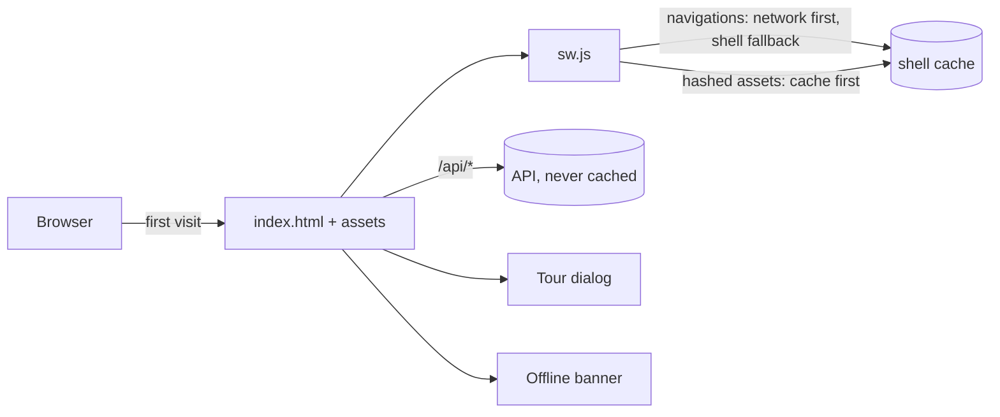

# Design Document: Field-ready

## Overview

Four small, independent pieces. None touches the server's data path or the permission model.

## Components

### Manifest and icons (Req 1)
- `client/public/manifest.webmanifest` is static and per app. The app name lives in the file; `scripts/summon.js` rewrites it for a new app.
- `scripts/make-icons.mjs` renders `public/favicon.svg` to `icon-192.png`, `icon-512.png`, `icon-maskable-512.png` (logo inside the safe zone on a solid background) and `apple-touch-icon.png` using the installed Chrome through `playwright-core`. It is run by the developer when the logo changes; the PNGs are committed. No build-time dependency.
- Theme colour comes from each app's `tokens.css` background, read once by the script and written into the manifest and the `theme-color` meta tag.

### Service worker (Req 2)
- `client/public/sw.js`, plain JavaScript, no library. Cache name carries a version constant (`shell-v1`) that the build stamps with a content hash, so every deploy replaces the old cache (`activate` deletes other `shell-*` caches).
- Strategies: navigations (`request.mode === 'navigate'`) go network first with a 4 s timeout and fall back to the cached `/index.html`; same-origin requests under `/assets/` are cache first (names are content-hashed); everything else passes through.
- Any request whose path starts with `/api/` or whose origin differs from the page's is not handled at all (the worker returns without calling `respondWith`).
- `src/lib/registerSW.js` registers it only when `import.meta.env.PROD` and `serviceWorker` is supported; it is a no-op in tests and development.
- A small Vite plugin in `vite.config.js` writes the content hash into `dist/sw.js` after the build.
- `netlify.toml` gets a `[[headers]]` block giving `/sw.js` and `/manifest.webmanifest` `Cache-Control: no-cache`.

### Offline banner (Req 2.5)
`components/layout/OfflineBanner.jsx` subscribes to `online` and `offline` events (initial value from `navigator.onLine`), renders a `role="status"` bar under the top bar, and renders nothing when online. Mounted in `AppShell`.

### Tour (Req 3)
- `components/layout/Tour.jsx` renders a `Dialog` with `steps` built from props (`appName`, `hasQr`, `example`), a progress indicator (`aria-label="Step 2 of 5"`) and Back/Next/Skip.
- `lib/tour.js` holds the pure parts: `buildSteps(opts)`, `tourKey(userId)`, `shouldAutoOpen({ seen, prod, webdriver, forced })`.
- Seen state is `localStorage['crypt-tour:<userId>']`. Automatic opening requires production, no `navigator.webdriver` and not seen; `?tour=1` forces it.
- `AppShell` owns the open state and passes `onTour` to the palette, which adds a "Take the tour" entry under Help.

### Assistant check (Req 4)
- `server/scripts/assistant-test.js` reads the same environment the server does (`loadEnv`), refuses to run without `BEDROCK_MODEL_ID`, sends a one-line Converse call, then runs `askAssistant` against an in-memory demo database with a question that needs a tool call. `explainAwsError(err)` is a pure function with a table of error names to advice, unit tested.
- `routes/health.js` adds `assistant: !!env.ASSISTANT`.
- `docs/BEDROCK.md` documents variables, the minimal IAM policy and the common errors.

## Testing strategy
- Unit: `tour.test.js` (`buildSteps`, `shouldAutoOpen` truth table), `Tour.test.jsx` (steps, keyboard, remember, replay), `OfflineBanner.test.jsx`, `registerSW.test.js`, `assistantCheck.test.js` (`explainAwsError`, health flag).
- Build: a test runs `vite build` output check that `dist` holds the manifest, icons and a stamped `sw.js`.
- Browser (local, production build served by `vite preview`): the manifest is valid and linked, the service worker activates, the app shell loads offline, API calls are not in the cache, the tour opens with `?tour=1` and not again after Skip.

## Risks
- A service worker that caches too much can show stale data. Mitigation: it never touches `/api/`, shell cache is replaced on every deploy, and `sw.js` itself is `no-cache`.
- A tour that blocks automated checks. Mitigation: no auto-open for `navigator.webdriver` or outside production.
