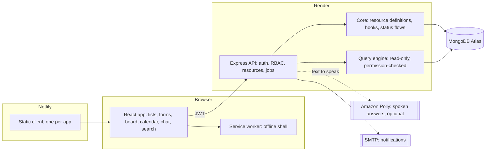
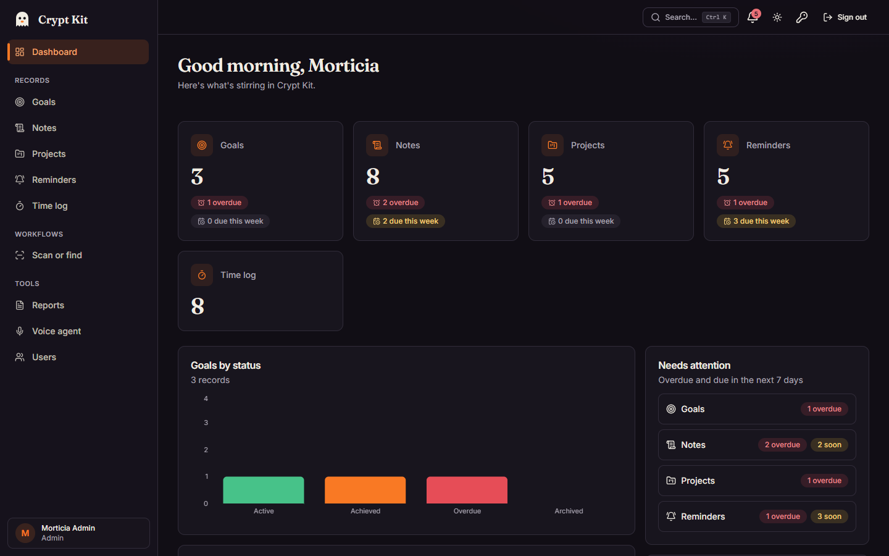
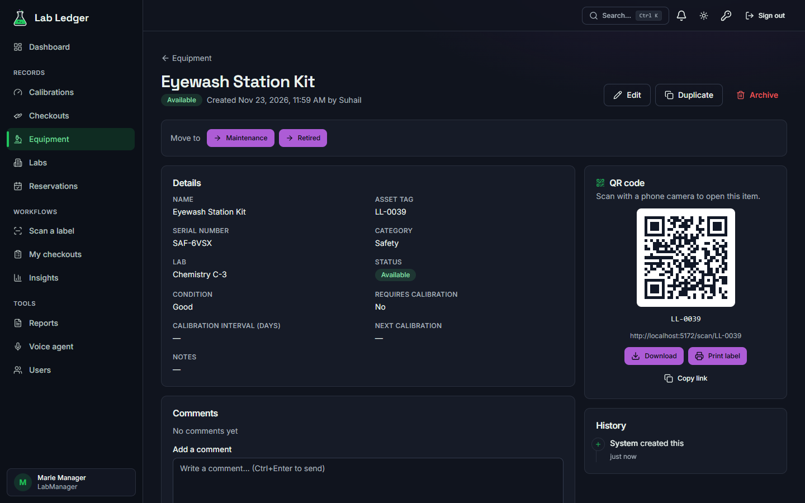
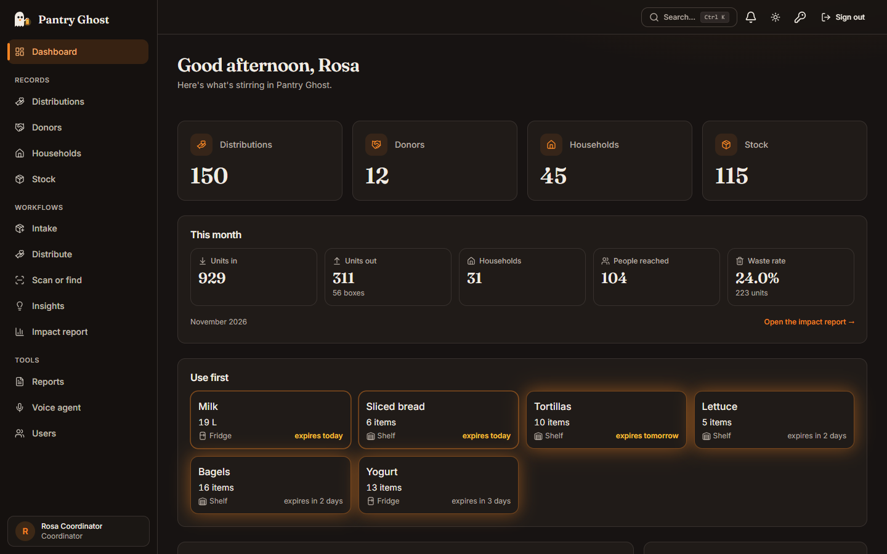
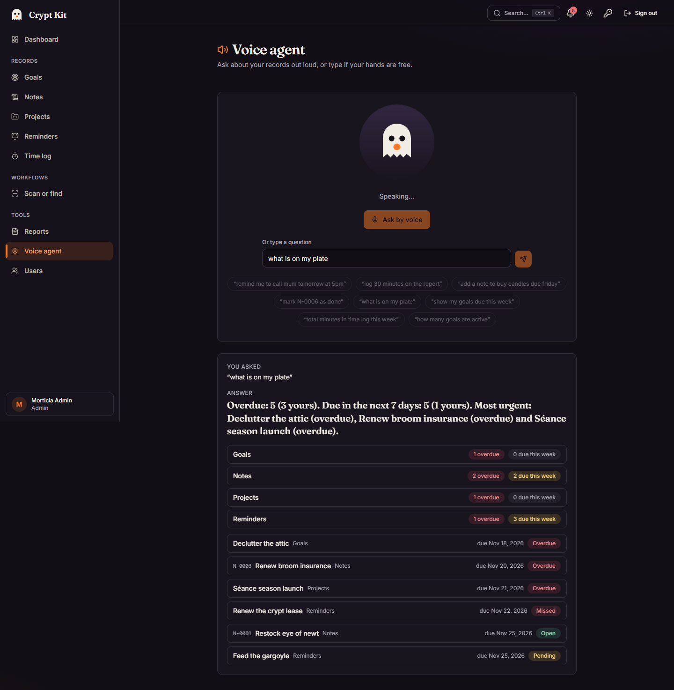
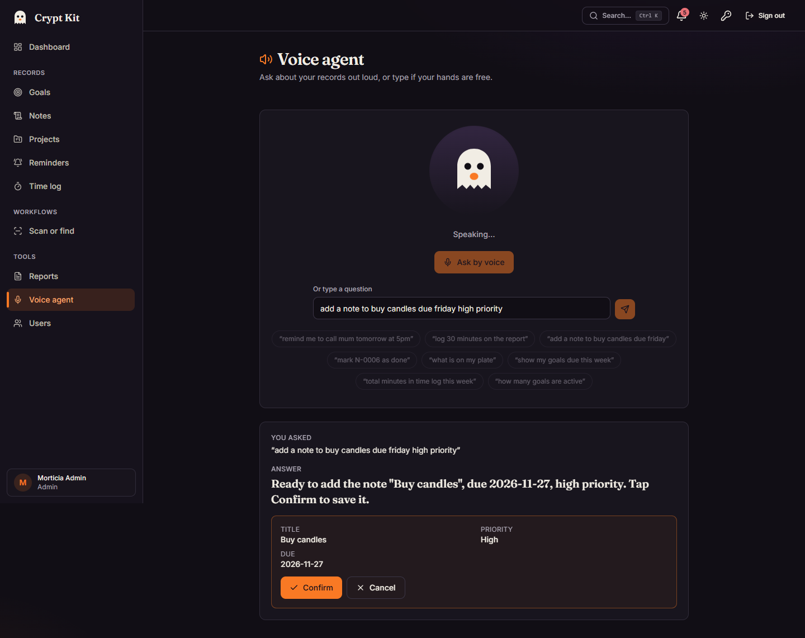
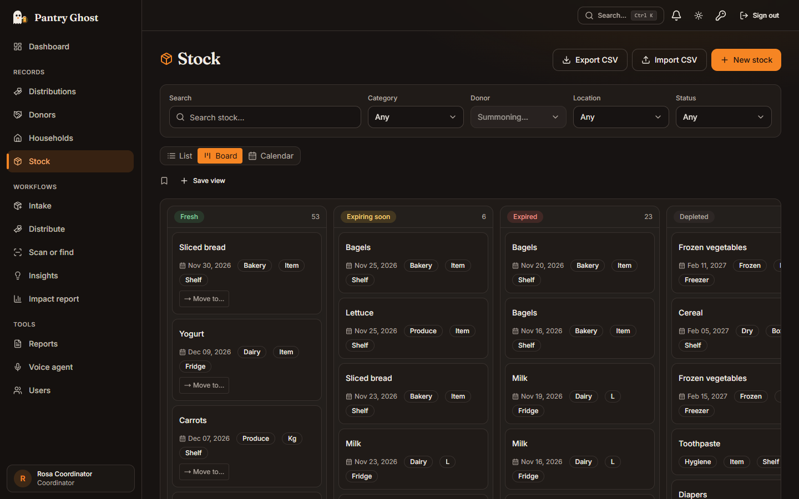
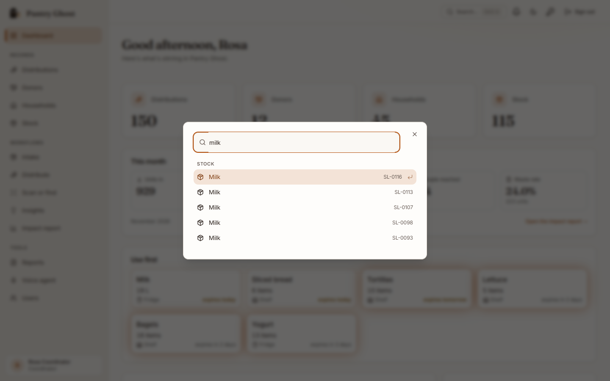
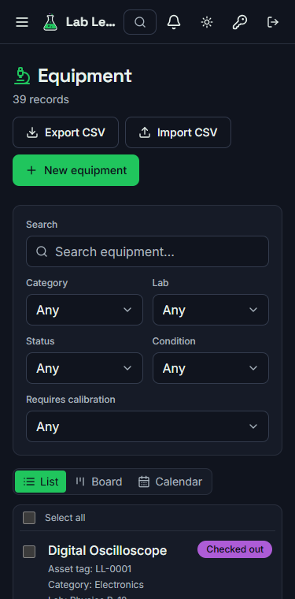
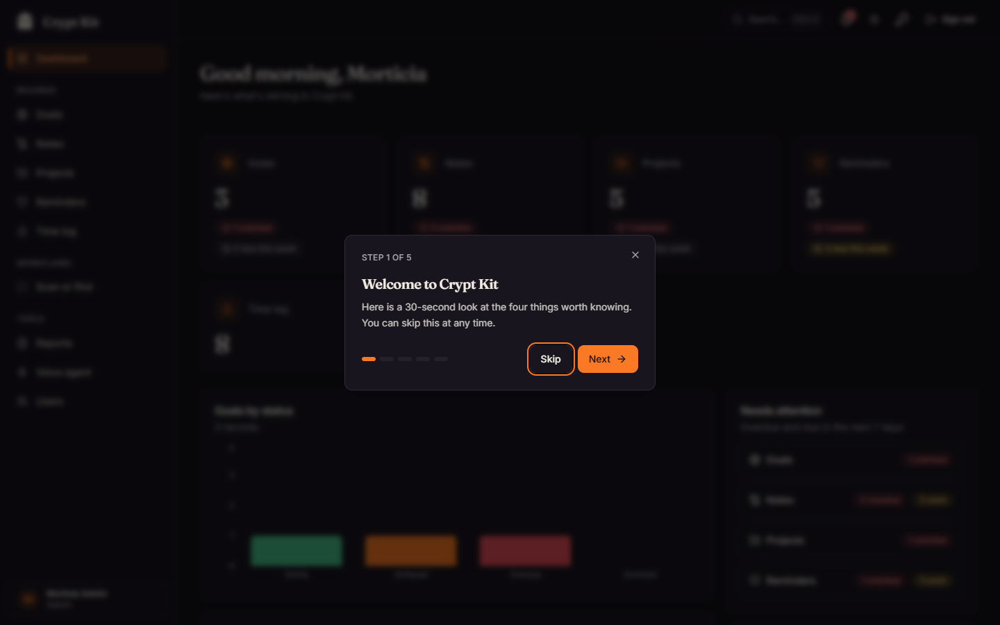

# 🦴 Crypt Kit

**Kiroween 2026 · Skeleton Crew.** One skeleton, three working apps: describe your records once, and get the API, the screens, the permissions, the PDFs, the QR labels and a chat assistant for free.

| Try it now | |
|---|---|
| 🦴 **Crypt Kit** (the skeleton, as a to-do suite) | https://crypt-kit.netlify.app |
| 🧪 **Lab Ledger** (teaching-lab equipment) | https://leb-ledger.netlify.app |
| 👻 **Pantry Ghost** (food-bank inventory) | https://pantry-ghost.netlify.app |

No sign-up needed: every login page has one-click demo buttons. The APIs sleep after 15 minutes idle (free hosting), so the very first request can take about a minute.

## Try it in 60 seconds

1. Open **Lab Ledger**, press **Student**, and pick *Scan a label*. Type `LL-0005` and request a checkout.
2. Open the same site in a second tab as **Technician**, search `LL-0005` (Ctrl+K) and press **Approve**.
3. Open the **Voice agent** and ask *"which items are overdue"*, *"what is on my plate"* or *"who has the oscilloscope"*. Answers list the records as links.
4. On **Crypt Kit**, type *"add a note to buy candles due friday high priority"*. You get a draft with **Confirm** and **Cancel**; nothing is saved until you confirm.
5. Open a note, tick a subtask, add a comment, then switch the list to **Board** and **Calendar**.
6. On a phone, use *Add to Home screen*: each portal installs as its own app, and opens even without a connection.

## Why it exists

Small teams run on spreadsheets and paper: labs lose track of who has the oscilloscope, food banks throw away what expired on the shelf. Each of those tools needs the same ten things (sign-in, roles, lists, forms, history, notifications, reports, search…) and then a little of what makes it theirs. Crypt Kit is the ten things, done once and tested hard, so an app is a few resource files. Lab Ledger and Pantry Ghost are two such apps. They look and behave nothing alike, yet their shared core is **byte-identical** (`npm run check:core` proves it).

## How it fits together



The one idea that matters: a **resource definition** (fields, roles, status flow, due rule) is the single source of truth. The server enforces it, the client renders from it, the chat assistant, the CSV import, the OpenAPI page and the tests read it too. A new app is new definitions, not new plumbing.

## Screenshots

| | | |
|---|---|---|
|  |  |  |
| Crypt Kit: dashboard | Lab Ledger: an item, its QR label, comments | Pantry Ghost: what to use first |
|  |  |  |
| Ask in plain words, get links | Commands are drafts until you confirm | Board view by status |
|  |  |  |
| Search everything (Ctrl+K), light theme | The same list on a phone | A 30-second tour on first visit |

The three apps in this repository:

| Folder | App | Who it's for | What it shows off |
|---|---|---|---|
| [`skeleton/`](skeleton) | **Crypt Kit** | Developers, and anyone who wants a to-do tool | The template itself, with a working to-do suite: Notes, Projects, Reminders, Goals and a Time log, plus RBAC, voice, PDF and cron |
| [`lab-ledger/`](lab-ledger) | **Lab Ledger** 🧪 | University teaching labs | Unique-item tracking: equipment checkout/return, reservations, calibration schedules, QR asset tags, "who has the oscilloscope?" by voice |
| [`pantry-ghost/`](pantry-ghost) | **Pantry Ghost** 👻 | Community food banks | Quantity-based stock: donation intake by voice, first-expiry-first-out picking, expiry and low-stock alerts, donor receipts, impact reports |

Raise your own with `npm run summon -- my-app`, then add resource files. The step-by-step is in [Raise your own app](#raise-your-own-app).

## Repository layout

```
crypt-kit/
├── .kiro/                  # Specs, steering, hooks, MCP config (committed on purpose)
│   ├── specs/
│   │   ├── crypt-kit-skeleton/   # requirements.md · design.md · tasks.md
│   │   ├── lab-ledger/
│   │   └── pantry-ghost/
│   ├── steering/           # product, tech, structure, conventions, testing
│   ├── hooks/              # agent hooks that automate the dev loop
│   └── settings/mcp.json   # MCP servers used during development
├── skeleton/               # the template (client + server)
├── lab-ledger/             # app #1 (client + server), raised from skeleton/
├── pantry-ghost/           # app #2 (client + server), raised from skeleton/
│   └── client/netlify.toml # (in each app) Netlify build settings and SPA redirect
├── e2e/                    # real-browser feature tests (local) and a read-only check of the live sites
├── scripts/summon.js       # copies skeleton/ into a new app folder
├── scripts/check-core.js   # proves Core is identical in every app
└── docs/                   # KIRO_USAGE.md (write-up) and screenshots/
```

## Quick start

Requirements: Node.js 20+, plus either MongoDB (local or Atlas) **or** nothing at all. If you set `DEMO_MODE=true`, the server runs an in-memory database seeded with demo data.

```bash
npm run install:all
cp lab-ledger/server/.env.example lab-ledger/server/.env   # edit as needed
npm run dev:lab
```

The client runs on http://localhost:5173 and the API on http://localhost:5000. Every environment variable is documented in each app's `server/.env.example` and in the [skeleton README](skeleton/README.md#environment-serverenv).

The voice agent listens with the browser's speech recognition and reads answers aloud with the browser's own voice, so judges need no keys. Set `VOICE_PROVIDER=polly` with AWS keys to have Amazon Polly speak instead ([`docs/POLLY.md`](docs/POLLY.md)); if Polly fails, the page falls back to the browser voice.

## Demo accounts (`DEMO_MODE=true`; the login page also has one-click buttons)

| App | Role → email / password |
|---|---|
| Skeleton | Admin `admin@crypt.test` / `crypt-admin-demo` · Member `member@crypt.test` / `crypt-member-demo` · Viewer `viewer@crypt.test` / `crypt-viewer-demo` |
| Lab Ledger | LabManager `manager@lab.test` / `lab-manager-demo` · Technician `tech@lab.test` / `lab-tech-demo` · Student `student@lab.test` / `lab-student-demo` |
| Pantry Ghost | Coordinator `coordinator@pantry.test` / `pantry-coordinator-demo` · Volunteer `volunteer@pantry.test` / `pantry-volunteer-demo` · Board `board@pantry.test` / `pantry-board-demo` |

Demo accounts cannot change or reset their password, so the one-click demo keeps working for everyone. Set `SEED_ADMIN_EMAIL` and `SEED_ADMIN_PASSWORD` to add your own owner account (the superuser role) next to them.

## Shared features (every app gets them from the skeleton)

| Feature | What it does |
|---|---|
| **Resources → full app** | One definition file gives API routes, list (search, filters, sorting), create/edit forms, a detail page with history, dashboard counts and voice answers. |
| **Faster lists** | Click anywhere on a row to open it (Ctrl/Cmd-click or middle-click opens a new tab). Click a column header to sort (ascending, descending, back to default; text sorts alphabetically, ignoring case). A **Mine** chip shows only records assigned to you. Date fields also accept `<field>_from` / `<field>_to` in the API. |
| **Board and calendar views** | Lists with a status flow get a **Board** (one column per status; drag a card, or use its *Move to…* menu, to change status within the allowed transitions). Lists with a due date get a **Calendar** (month grid, agenda on phones). The view is kept in the URL and remembered per list. |
| **Subtasks (checklist field)** | `{ type: 'checklist' }` gives a tickable list with a progress bar in forms and on the detail page, `2/5` in lists, and CSV import/export as `[x] done; [ ] to do`. |
| **Comments** | A thread on every record's detail page (on unless the definition says `comments: false`). Anyone who can read the record can comment; authors and the superuser can delete. The record's creator and the people assigned to it are notified. The history notes that a comment was added but never copies its text, so a deleted comment is gone everywhere. Limited to 30 per 15 minutes per user. |
| **Search everywhere** | **Ctrl/Cmd + K**, **/** or the *Search…* button opens a palette that finds records in every resource you may read (up to 5 per resource), jumps to pages and starts *Create new …*. API: `GET /api/search?q=`. |
| **Chat assistant** | The Voice agent page answers typed or spoken questions in plain words, with no AI needed: any resource by its spoken names (plurals and small typos), statuses and other values ("high priority", "not done"), "overdue" in any spelling, dates ("due this week", "added last month", "friday"), "mine" or "assigned to Igor", text ("about candles"), totals ("total minutes this week", "how many hours did I log"), an overview ("what is on my plate"), lookup by ID ("tell me about N-0006"), help and greetings. Answers list the records as links, with "see all". Dates follow the user's own timezone. In Crypt Kit it also takes commands, "add a note to buy candles due friday", "remind me to call mum tomorrow at 5pm", "log 30 minutes on the report", "mark N-0006 as done", and shows a draft with **Confirm** and **Cancel**: nothing is saved until Confirm. Answers can be read aloud, by the browser voice or by Amazon Polly when it is switched on. |
| **Installable and offline-ready** | Each portal is a web app with its own icon: use *Add to Home screen* and it opens like an app, and still opens (with an "offline" banner) when there is no connection. A service worker keeps only the app shell; it never stores records or anything from the API. |
| **First-run tour** | A 30-second dialog on a first visit points out search, the assistant, scanning and the theme toggle. Replay it from the search box ("tour"). |
| **Duplicate** | The detail page's *Duplicate* button opens a prefilled new-record form (IDs, status and unique fields are left out, subtasks come back unticked). |
| **Roles and permissions** | Ordered roles in `crypt.config.js`; the first is the superuser. The server enforces every permission and the UI hides what you cannot do. |
| **Accounts** | *Create an account* on the login page: new accounts wait until an admin presses **Approve** on Users. *Forgot password* emails a one-time reset link that expires after 30 minutes. *Change password* is the key icon in the top bar. Password fields have a show/hide (eye) button, and signing out asks for confirmation. |
| **Rate limits** | Sign-in: 10 attempts per 15 minutes per IP and email (`LOGIN_RATE_MAX`). Sign-up and forgot-password: 5, reset: 10 per 15 minutes per IP (`AUTH_RATE_MAX`). Change password: 10 per user, test email: 5 per user. Behind a proxy set `TRUST_PROXY=true`. |
| **Notifications** | Bell in the top bar with unread badge. Due rules notify the superuser, the users on the record, and any roles in `notifyRoles` (`crypt.config.js`); resources in `routineDueRules` change status without notifying. The same event never notifies twice. |
| **Email** | Notifications, sign-up approvals and reset links are emailed through any SMTP service (tested with Brevo). Set `SMTP_HOST`, `SMTP_PORT`, `SMTP_USER`, `SMTP_PASS`, `MAIL_FROM` and optionally `MAIL_REPLY_TO`; leave them empty to keep alerts in-app only. A half-filled setup stops the server with a clear message. The bell has an *Email me a test* button (its message warns that mail may land in spam), and `npm run mail:test -- you@example.com` sends one from the command line. Addresses on reserved test domains (`.test`, `.example`, `.invalid`, `.localhost`) are skipped, so demo accounts never bounce. Mail sent "from" a free address such as Gmail often lands in spam: use a sender on your own verified domain for real use. |
| **QR codes and short IDs** | Records listed in `client/src/qrCodes.js` get a readable ID (`N-0001`, `LL-0001`, `SL-0001`) and a QR card on their detail page: download PNG, print a label, copy the link. The QR opens `<CLIENT_URL>/scan/<ID>`; signed-out visitors sign in first and then land on the item. Existing records get IDs by a boot-time backfill job. QR codes stay black on white in every theme so scanners can read them. |
| **Scan or find** | `/scan` reads a QR code with the camera (`BarcodeDetector`, or `jsQR` in browsers without it), from a photo or screenshot, or from a typed ID or pasted link. Links to other websites are reported, never opened. |
| **QR label sheets** | Select rows on a list and use *Print QR labels*: an A4 sheet of 3 × 8 labels, each with the QR code and its ID. |
| **CSV export / import** | Every list has *Export CSV* (follows the active search and filters) and *Import CSV*, which checks the file first and writes nothing until you confirm. API: `GET /api/r/:key/export`, `POST /api/r/:key/import` (`dryRun` defaults to true). |
| **PDF reports** | Report presets and per-app PDFs (audits, impact, receipts, insights, labels) use the portal's own colours from `reports.theme` in `crypt.config.js`. |
| **Saved views** | Save the current search and filters on any list as a named chip (kept in this browser). |
| **Date and time fields** | `{ type: 'date', time: true }` renders a date-time picker; `formHidden: true` keeps a field out of the forms but in lists and details. |
| **OpenAPI docs** | `GET /api/docs` (signed in) returns an OpenAPI 3 document built from the resource definitions. |
| **Database safety** | `MONGODB_DB_NAME` picks another database on the same cluster. `SEED_ON_BOOT` only works when that name ends in `_test`, and `DEMO_PERSIST` (demo data in a real cluster) only when it ends in `_demo` or `_test`. |

## Tests

```bash
npm test              # summon tests, then server + client suites for all three apps
npm run check:core    # proves Core is byte-identical in skeleton, lab-ledger and pantry-ghost
npm run smoke --prefix lab-ledger/server   # boots demo mode and runs the HTTP checks (likewise for each app)
```

| | Server | Client | Smoke | Browser (e2e) |
|---|---|---|---|---|
| Skeleton | 300 | 205 | 31 checks | 72 steps |
| Lab Ledger | 354 | 211 | 40 checks | 60 steps |
| Pantry Ghost | 367 | 205 | 30 checks | 51 steps |

The browser suite in [`e2e/`](e2e) drives real Chrome through every feature (sign-in per role, CRUD, accounts, CSV, notifications and email, QR cards, scanning a photo of a QR, label sheets, clickable rows, sorting, board and calendar views, search palette, comments, subtasks, duplicate, dialogs on desktop and mobile, and a sweep for `[object Object]`). `npm run live --prefix e2e` runs a read-only pass over the three live sites (36 steps, every demo role). `npm run responsive --prefix e2e` opens every page at five widths from 320 to 1440 px and flags sideways scrolling and tap targets under 24 px. `npm run themes --prefix e2e` visits every page of the local portals in dark and light, on desktop and phone, saves a screenshot of each and fails on unreadable text, white form controls or sideways scrolling (about 490 screens, including the chat answers, the tour and the offline banner, none flagged).

The tests include 33 property-based correctness properties (`fast-check`), each linked to spec requirements. See [docs/KIRO_USAGE.md](docs/KIRO_USAGE.md).

## Deploy (Netlify + Render + MongoDB Atlas)

Each app is two deploys from this one repo: the client on Netlify and the API on Render. The API runs on Render because the server runs scheduled jobs and must stay running as a normal process.

**1. API on Render.** New > Web Service, pick this repo, once per app:

| Setting | Value |
|---|---|
| Root Directory | `skeleton/server`, `lab-ledger/server` or `pantry-ghost/server` |
| Runtime / Build / Start | Node / `npm install` / `npm start` |
| Health Check Path | `/api/health` |

Environment variables, per service:

```
DEMO_MODE=true
DEMO_PERSIST=true
TRUST_PROXY=true
MONGOMS_DISABLE_POSTINSTALL=1
MONGODB_URI=<your Atlas connection string>
MONGODB_DB_NAME=lab_ledger_demo          # crypt_kit_demo / pantry_ghost_demo for the other two
JWT_SECRET=<48+ random characters, different per service>
CLIENT_URL=https://<this app's Netlify site>.netlify.app
# optional email (Brevo) and owner account
SMTP_HOST=smtp-relay.brevo.com
SMTP_PORT=587
SMTP_USER=
SMTP_PASS=
MAIL_FROM=
MAIL_REPLY_TO=
SEED_ADMIN_EMAIL=
SEED_ADMIN_PASSWORD=
SEED_ADMIN_NAME=
```

- `DEMO_MODE` + `DEMO_PERSIST` keep the one-click demo accounts and store the demo data in Atlas. The server refuses to start in this mode unless `MONGODB_DB_NAME` ends in `_demo` or `_test`, so your real databases are never opened. The first start seeds the demo data; later starts add nothing.
- `TRUST_PROXY=true` makes the rate limits count each visitor rather than Render's proxy.
- `MONGOMS_DISABLE_POSTINSTALL=1` skips downloading the in-memory MongoDB binary, which is not used here.
- `CLIENT_URL` has no trailing slash. It is used for CORS, email links and the address inside QR codes.
- In Atlas > Network Access allow `0.0.0.0/0`, since Render's outgoing addresses change.
- Generate `JWT_SECRET` with `node -e "console.log(require('crypto').randomBytes(48).toString('hex'))"`.
- After changing variables, redeploy (Manual Deploy > Deploy latest commit). The log should show `MongoDB connected: ... [db: <name>_demo]`.

**2. Client on Netlify.** Add a new site from this repo, once per app:

| Setting | Value |
|---|---|
| Base directory | `skeleton/client`, `lab-ledger/client` or `pantry-ghost/client` |
| Build command / publish directory | read from that folder's `netlify.toml` (`npm run build`, `dist`) |
| Environment variable `VITE_API_URL` | The Render URL plus `/api`, e.g. `https://lab-ledger.onrender.com/api` |

`VITE_API_URL` is built into the client, so redeploy the site after changing it (Clear cache and deploy site). Each `netlify.toml` also sends every path to `index.html`, so links like `/scan/LL-0001` and `/reset-password?token=...` open directly.

## Raise your own app

```bash
npm run summon -- my-app
```

Then add resource files in `my-app/server/src/resources/` and restart. See [`.kiro/specs/crypt-kit-skeleton/design.md`](.kiro/specs/crypt-kit-skeleton/design.md).

## License

[MIT](LICENSE)
